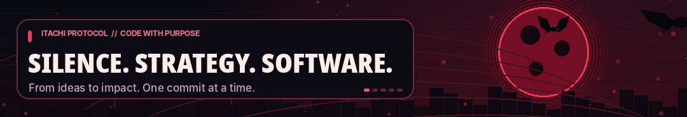
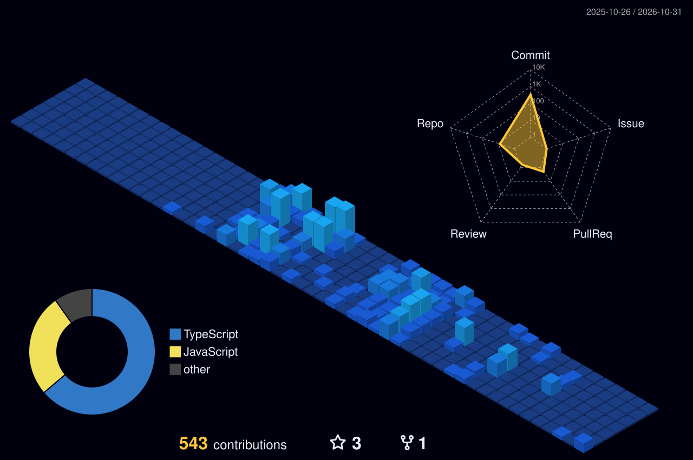

<!-- AKATSUKI // ROSHAN -->

 

<!-- Animated Akatsuki ravens -->

 

<!-- MY NINJA WAY -->

 

<!-- JUTSU ARSENAL -->

 

<!-- SHINOBI DOSSIER -->

 

<!-- S-RANK MISSIONS: CUSTOM ANIMATED AKATSUKI CARDS -->

 

<!-- CLICKABLE PROJECT LINKS -->

  

<!-- LIVE GITHUB COMMIT TRACKER -->

 

<!-- CONTRIBUTION VILLAGE -->

 

<!-- 3D CONTRIBUTION GRAPH -->

 

<!-- CONNECT SECTION -->

 

  

  

<b>Built with purpose. Sharpened by every commit.</b>

