<!-- A K A T S U K I   / /   R O S H A N -->

 

<!-- Real animated GIF, in addition to CSS-animated SVGs. -->

 

 

 

 

<!-- Projects remain accessible and clickable in GitHub Markdown. -->
<table>
  <thead><tr><th align="left">S-RANK MISSION</th><th align="left">WHAT IT DOES</th><th align="left">JUTSU / STACK</th></tr></thead>
  <tbody>
    <tr>
      <td><a href="https://pharmily-pm.web.app/"><b>PHARMILY</b></a></td>
      <td>Healthcare management with SOS workflows, appointments, RBAC and real-time updates.</td>
      <td><code>React</code> <code>Express</code> <code>MongoDB</code> <code>Socket.IO</code></td>
    </tr>
    <tr>
      <td><b>VAANI</b></td>
      <td>Voice-first civic assistance platform designed for multilingual accessibility.</td>
      <td><code>AWS</code> <code>Bedrock</code> <code>Voice AI</code></td>
    </tr>
    <tr>
      <td><a href="https://github.com/roshan-1205/VIBELY"><b>Vibely</b></a></td>
      <td>Social platform featuring real-time chat, media posting and dual authentication.</td>
      <td><code>Next.js</code> <code>Express</code> <code>MongoDB</code></td>
    </tr>
    <tr>
      <td><b>AKS Beauty Hut</b></td>
      <td>Client e-commerce project with responsive catalog, checkout and inventory management.</td>
      <td><code>MERN</code> <code>JWT</code></td>
    </tr>
    <tr>
      <td><b>FleetWatch (Team Project)</b></td>
      <td>Hackathon fraud-detection system exploring reinforcement learning and model adaptation.</td>
      <td><code>Python</code> <code>RL</code> <code>LoRA</code></td>
    </tr>
  </tbody>
</table>

<a href="https://github.com/roshan-1205?tab=repositories"><b>Explore all my repositories</b></a>

  

<!-- First shows a designed no-data placeholder; workflow replaces it with real GitHub data. -->

 

 

<!-- Initial placeholder is replaced after the 3D contribution workflow completes. -->

 

 

  

  

<b>Built with purpose. Sharpened by every commit.</b>

